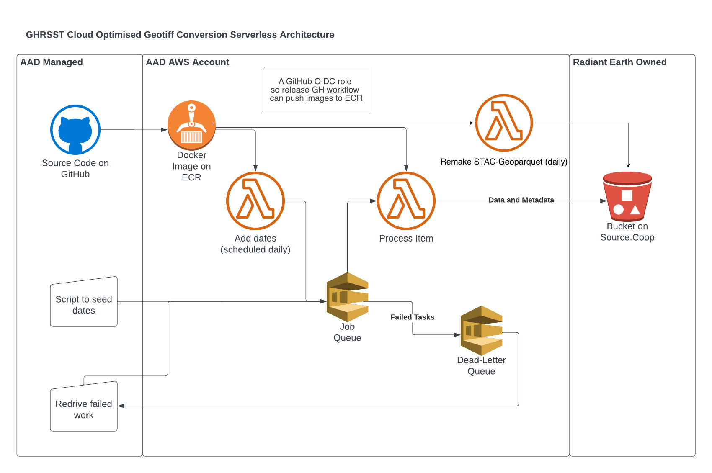

# GHRSST Cogger and Lambda Function

## Overview

The architecture for this process has the following components:

* The code in this respository, including the [cog creation](ghrsst_cogger.py)
  and [date seeding](ghrsst_dategen.py) for the SQS queue
* A Docker image, with a [Dockerfile](Dockerfile)
* Terraform infrastructure as code, which includes:
  * An SQS queue to hold tasks
  * An SQS dead-letter queue to handle failed tasks
  * A Lambda that runs the work that arrives on the queue
  * A Lambda and CloudWatch scheduling that runs every day to seed tasks
    for the last seven days, ensuring that data stays up to date. Note that
    any work that's already been done is skipped.

.

## Quickstart

Dependencies are managed with [uv](https://docs.astral.sh/uv/). Python 3.12 is pinned in
`.python-version` and uv will download it if needed.

rasterio is built from source against the system GDAL (`no-binary-package` in
`pyproject.toml`) rather than using the wheel's bundled GDAL, so the COG writing uses the
same GDAL as the Docker image. This means `uv sync` needs GDAL installed locally
(e.g. `brew install gdal`, so that `gdal-config` is on the `PATH`).

```bash
uv sync
source .venv/bin/activate
prek install  # run ruff, ty and file checks on each commit

make test       # tests that need the sample NetCDF in data/ are skipped without it
make lint       # all prek hooks on all files: ruff, ty, uv lock --check
make run-local  # convert one date from data/ to data/output
```

Add a dependency with `uv add <package>` (or `uv add --dev <package>`), which updates
`pyproject.toml` and `uv.lock`. Commit both.

Build the Lambda image with `make build VERSION=x.y.z` and run the tests inside the image
with `make test-docker`.

## Cost calculation

Lambda costs `0.0000133334` per GB second. We're running with `10 GB` of memory. Each
job takes around 5 minutes, and there's around 10,000 jobs. So we have a total cost
of `10000 * 0.0000133334 * 10 * 5 * 60` which is `$400` USD. Running each day to convert
the latest data costs almost nothing.

## Infra deployment v2

Create secrets on AWS for the Earthdata username and password.

```bash
aws secretsmanager create-secret \
    --name earthdata-username \
    --secret-string secretusername \
    --region us-west-2
```

```bash
aws secretsmanager create-secret \
    --name earthdata-password \
    --secret-string secretpassword \
    --region us-west-2
```

Create secrets for AWS Access and Secret key for the prod bucket.

```bash
aws secretsmanager create-secret \
    --name source-coop-access-key \
    --secret-string accesskey \
    --region us-west-2
```

```bash
aws secretsmanager create-secret \
    --name source-coop-secret-key \
    --secret-string secretaccesskey \
    --region us-west-2
```

Manually create a bucket that will be used for [storing Terraform state](https://developer.hashicorp.com/terraform/language/backend/s3).

```bash
aws s3 mb s3://aad-ghrsst-terraform-state
```

Configure terraform bucket and path in the top of the [terraform/main.tf](terraform/main.tf) file.

Initialise, pland and apply using the terraform command line:

* `terraform init`
* `terraform plan`
* `terraform apply`.

This will likely fail on the Lambda step, so
[push the Docker image](https://docs.aws.amazon.com/AmazonECR/latest/userguide/docker-push-ecr-image.html).

```bash
# Authenticate with ECR

# Push the image

```

Now apply again: `terraform apply`.


## Infra deployment

Create a secret on AWS for the Earthdata variable.

```bash
aws secretsmanager create-secret \
    --name earthdata-token \
    --secret-string longsecretgoeshere \
    --region us-west-2
```

Initialise first with `terraform init`, then `terraform plan` to see what will
change, and then when happy run `terraform apply`.

Note that the first deploy will fail on the Lambda step, but will
have created the ECR repository, so push an image, then re-apply, and
it should work.

## Notes on GitHub Actions

This should have a Terraform process to create the ECR and use OIDC for auth
for pushing the image from Actions to AWS. (Or the equivalent in Bitbucket.)
